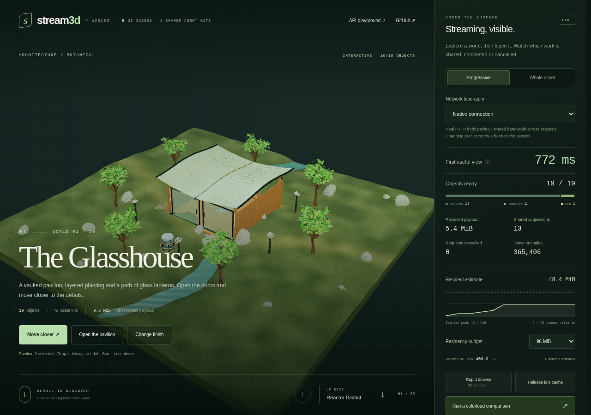

# Stream3D

**用普通的场景 API 创建交互式 3D，由框架负责渐进加载、资源共享和回收。**

Stream3D 的第一版是一套 TypeScript 框架：构建时把 glTF / GLB 编译成多个独立的几何与纹理层级；运行时先显示可交互的低精度版本，再根据屏幕占比和内存预算提升质量。用户切换场景时，框架会撤销过期任务、释放不再需要的引用，并保留预算内可复用的缓存。

这是 **v0.1 的可运行实现**，采用 Three.js / WebGL2 后端。目前通过本仓库开发和使用，尚未发布到 npm。

## 立即运行

需要 Node.js **22.12+**，建议 Node.js 24。

```bash
git clone https://github.com/ziyu/stream3d.git
cd stream3d
npm ci
npm run dev
```

打开终端给出的地址，默认是 `http://127.0.0.1:5173`。

- **内容流 `/` 或 `/feed.html`**：30 个组合场景，每页 18–24 个对象，来自 6 套共享资产。纵向滑动浏览、横向拖动旋转，查看渐进质量、请求取消、缓存复用和驻留预算，并运行受控加载比较。
- **API 调试台 `/inspector.html`**：调整相机距离和预算、添加共享实例、修改材质、播放动画，查看原始诊断。
- **最小内容流 `/minimal.html`**：保留原来的三个雕塑场景，方便阅读最小接入代码。

示例的建筑、机械、植物、地形、珊瑚和灯具均由仓库源码生成，包含真实几何、纹理和动画。仓库不附带生成的模型二进制，也不下载第三方模型；首次启动会生成源 GLB 并编译三个质量档位。详见[内容流演示与测量指南](docs/showcase.md)。



上图为真实 Chromium 运行截图，来自 [CI 879db2a](https://github.com/ziyu/stream3d/actions/runs/42961406917)，拍摄于首档体积进一步缩小之前。图中的时间和帧间隔属于该次软件渲染会话；当前配置和复现方法见[测量指南](docs/showcase.md)。

## 开发者体验

Vite 插件负责把普通 glTF / GLB 转换成可渐进加载的资产：

```ts
// vite.config.ts
import { defineConfig } from 'vite';
import { stream3d } from '@stream3d/vite';

export default defineConfig({
  plugins: [stream3d()],
});
```

```ts
// src/vite-env.d.ts
/// <reference types="@stream3d/vite/client" />
```

```ts
import { createApp } from 'stream3d';
import { HemisphereLight } from 'three';
import sculpture from './assets/sculpture.glb?asset';

const canvas = document.querySelector<HTMLCanvasElement>('canvas')!;
const app = createApp({ canvas, controls: true });
const scene = app.createScene();
scene.root.add(new HemisphereLight(0xffffff, 0x445566, 3));
scene.camera.position.set(0, 0.5, 5);

// 立即得到稳定的逻辑对象，不需要等待 GLB 下载、解码和上传。
const model = scene.addModel(sculpture);
model.position.set(0, 0, 0);
model.scale.setScalar(1);
model.animation.play('Idle'); // 使用源模型中实际存在的动画名称。
model.materials.set('Body', { color: '#b5ebdb' });
model.on('click', () => model.animation.play('Pulse'));
model.on('error', ({ error, level }) => console.error(level, error));

app.present(scene);

try {
  await model.ready('interactive'); // 首个可交互版本就绪，不等待最高精度。
} catch (error) {
  // 等待期间退出场景会以 AbortError 结束；真实加载失败也会在此抛出。
  if (!(error instanceof Error && error.name === 'AbortError')) console.error(error);
}

// 页面或组件卸载时：app.destroy()
```

`Idle`、`Pulse`、`Body` 是示例资产中的名称，业务资产应使用自己的动画和材质名称。相机按资产自身的单位和范围配置。框架提供稳定的模型根节点；具体网格、纹理和渲染对象会随质量档位替换。

### 场景切换与资源自动回收

```ts
const next = app.createScene();
const other = next.addModel(sculpture);
other.position.x = 1;

app.present(next); // 前一个场景停止活动，未完成的无用请求被撤销。
app.present(scene); // 重新使用预算内仍然保留的下载/解码缓存。

other.destroy(); // 释放该实例的所有权，不影响仍使用相同资产的实例。
next.destroy();  // 递归销毁场景中的 managed models。
app.destroy();   // 终止 RAF、请求、上传任务，释放整个 app 的托管资源。
```

引用清零后进入可回收缓存；超过预算或空闲期限时释放。当前仍被使用的资源不会被缓存淘汰器强行销毁。无需为托管模型逐个调用 geometry / material / texture 的 `dispose()`。

### 调整策略

```ts
const app = createApp({
  canvas,
  budgets: {
    gpuBytes: 32 * 1024 ** 2,
    cacheBytes: 48 * 1024 ** 2,
    decodeConcurrency: 2,
  },
  refinementDelayMs: 350,
  offscreenGraceMs: 750,
  meshoptWorkers: 2,
  maxPixelRatio: 1.5,
});

app.setBudgets({ gpuBytes: 16 * 1024 ** 2 });
console.log(app.diagnostics());
```

`gpuBytes` 是托管表示的**估计驻留内存软预算**，不是 GPU 驱动报告的实际显存。运行时会保留替换余量并选择较低质量；即使预算低于所有可见模型最低档的总量，也优先保留这些可交互模型，并通过 `gpuPressure` 报告压力。

## 已实现的链路

| 部分 | v0.1 行为 |
| --- | --- |
| 资产编译 | 自动简化网格、缩放纹理、Meshopt 编码、生成 manifest 和内容寻址文件 |
| 首次加载 | 总是先加载最低档，再逐档提升；无需完整下载源模型 |
| 质量选择 | 依据模型屏幕占比、滞回阈值、停留时间和估计内存预算 |
| 自然 API | 位置、旋转、缩放、命名材质覆盖、命名动画、点击事件 |
| 状态保持 | LOD 替换保留逻辑对象、变换、动画时间、材质覆盖和事件订阅 |
| 资源复用 | 同一 app 内对相同表示合并请求、共享解码模板与几何/纹理 |
| 生命周期 | 独立消费者引用；最后消费者退出后取消；过期结果清理；场景/应用销毁 |
| 浏览器调度 | 独立网络/解码队列、Meshopt workers、shader 预热、分帧纹理上传 |
| 开发接入 | Vite `?asset`、热重载依赖追踪、CLI、可静态部署的产物 |
| 诊断 | 活跃实例、缓存命中、队列、质量档位、错误、实际响应体字节、请求状态、准备耗时和估计内存 |

### 内容流与受控比较

内容流使用一个 canvas，最多保留当前页及相邻两页的逻辑场景，只激活当前场景。相同资产在多个对象和页面间共享表示；切换时仍被下一页需要的请求会继续，其他过期工作会被撤销。逻辑场景窗口和资产缓存分别管理，离开一页不等于立即删除所有可复用数据。

本地 `dev` / `preview` 服务提供真实的 HTTP 响应体限速：同一会话的所有 GLB 请求共享 8 Mbps 或 1.6 Mbps 的速率预算，并分别加入 80 ms 或 180 ms 的响应等待。比较工具以相同场景、相机和最高档 GLB，对比渐进加载与直接加载最高档；每次使用新 runtime 和独立的 `no-store` 资产 URL。结果由当前运行测得，可下载 JSON。

面板区分实测响应体字节、主线程 RAF 间隔和估计驻留内存。帧间隔 p95 取最近最多 180 个样本；首次有用画面定义为地形与主体准备好后再经过两个 RAF 回调。每个档位都是独立 GLB，渐进模式可能传输更多总字节。比较不包含引擎首次下载，也不代表固定帧率或通用加速比例；完整条件与缓存边界见[测量指南](docs/showcase.md)。

## CLI 与静态部署

```bash
npm run build
npx stream3d compile ./model.glb --out ./public/assets/model
```

编译器输出 `asset-<hash>.stream3d.json` 和多个 `level-<hash>.glb`。它们可以直接托管在普通静态服务器或 CDN 上：

```ts
const model = scene.addModel('/assets/model/asset-<hash>.stream3d.json');
```

这里的字符串必须指向 **Stream3D manifest**。原始 `.glb` 需要先经过 CLI 或构建插件处理。跨域部署需要允许对应资源的 CORS 请求；WebP 纹理位于编译后的 GLB 内，不需要外部纹理路径。

## 仓库结构

| 路径 | 包 / 用途 |
| --- | --- |
| `packages/core` | `@stream3d/core`：manifest、任务调度、资源池、所有权作用域 |
| `packages/compiler` | `@stream3d/compiler`：离线编译和 `stream3d compile` CLI |
| `packages/runtime` | `stream3d`：场景、模型、Three.js 后端和自动资源策略 |
| `packages/vite` | `@stream3d/vite`：资产导入、开发服务、生产构建 |
| `examples/playground` | 30 场景内容流、HTTP 实验室、API 调试台与最小 feed |
| `scripts/generate-showcase.ts`、`scripts/showcase` | 生成六套原创建筑、机械与自然资产 |
| `scripts/generate-fixtures.ts` | 生成调试台和最小 feed 使用的雕塑资产 |

## 验证与构建

```bash
npm run check        # 库和示例类型检查 + 单元/集成测试
npm run build:demo   # 生成资产，编译库，构建四个示例入口
npx playwright install chromium
npm run test:browser # 对 production build 运行真实浏览器回归
npm run preview     # 在 http://127.0.0.1:4173 预览 dist/playground，含 HTTP 实验室
```

单元/集成测试覆盖资源所有权、取消和晚到结果、缓存恢复、真实 glTF 编解码、动画/蒙皮/morph 保持，以及 Vite 的子路径、CDN 和相对 base。浏览器回归用例包括渐进加载、状态保持、共享实例、快速切换、预算降档、销毁和内容流。CI 配置为使用 Linux / Node.js 24 运行上述验证；实际通过情况以运行结果为准。

`dist/playground` 可以静态部署。普通静态托管不包含本地 HTTP 实验室，页面会使用直接交付模式并关闭受控比较；3D 内容流和运行时资源策略仍可使用。

## 当前边界

- 渐进性以**完整离散档位**为单位；还没有连续 mesh refinement、虚拟纹理、逐纹理页加载或 HTTP Range 容器。
- 运行时下载缓存与解码表示分别管理；CPU 对象和 GPU 资源尚未实现独立分页。驻留估计不包含浏览器、驱动及全部实例开销。
- 上传有每帧数量和软时间限制，单个 WebGL 上传和部分 glTF 对象构建无法被抢占。复杂资产仍需控制最低档体积、材质数量和 shader 复杂度；当前没有承诺任意模型/设备上的固定首帧耗时或帧率。
- 默认 `full` 档纹理最长边是 1024，支持编译时自定义。简化比例是目标，不保证每种拓扑都达到指定三角形比例。
- 输入支持 glTF / GLB、PNG / JPEG / WebP 纹理以及 Draco 网格；KTX2 / AVIF、非三角形 primitive 和未覆盖的语义扩展会明确报错。
- manifest 包围盒是默认场景的静态作者姿态；没有动画包络时，运行时对动画模型的屏幕外回收采取保守策略。
- 自动管理仅覆盖 `scene.addModel()` 创建的托管资源。通过 `scene.root` 添加的自定义 Three.js 资源由调用方负责释放。
- 首版以 WebGL2 为目标；物理、音频、React 组件、WebGPU 后端、通用材质编辑器和跨 app 的全局 GPU 缓存未包含在内。

更详细的说明见[内容流演示与测量](docs/showcase.md)、[架构](docs/architecture.md)、[资产管线](docs/assets.md) 和 [API](docs/api.md)。

## License

[MIT](LICENSE)。示例资产由本仓库脚本生成。
