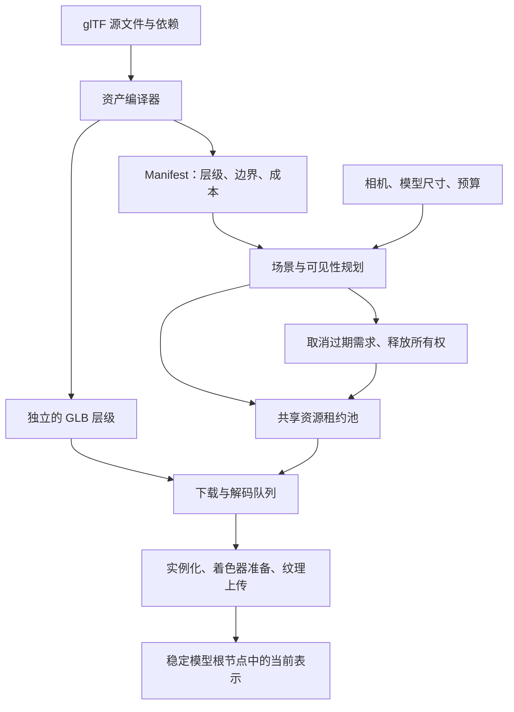

# 运行时架构与资源生命周期

Stream3D 把资产准备和浏览器运行时配合起来：构建时生成多个可以独立渲染的 GLB；运行时根据当前场景、可见性、投影尺寸和内存预算选择表示。应用拿到稳定的模型对象，可以立即设置位置、材质覆盖和动画状态，具体的几何与纹理由运行时按需获取、替换和释放。

当前版本采用 **完整 GLB 之间的离散 LOD 替换**。每个层级都要下载并解析完成，才会成为可用表示。层级之间没有差量编码，也不会在单个 GLB 尚未下载完时显示部分网格。资产配置、格式与部署方法见 [资产编译与构建集成](assets.md)。

## 1. 四个包的职责

| 包 | 运行位置 | 职责 |
| --- | --- | --- |
| `@stream3d/compiler` | Node.js，开发或构建阶段 | 读取 glTF，自动生成 LOD、调整纹理、编码 Meshopt、输出 manifest 和 GLB。 |
| `@stream3d/vite` | Vite 开发服务器及构建过程 | 实现 `.glb?asset` / `.gltf?asset` 导入，观察源依赖，提供开发 URL，向生产构建写入静态资产。 |
| `@stream3d/core` | 浏览器或宿主程序 | 校验 manifest；提供可复用的资源租约池、任务调度器和作用域释放工具。 |
| `stream3d` | 浏览器 | 提供 App、Scene、ManagedModel；根据需求选择 LOD，管理资源和实例，并用 Three.js 渲染。 |



默认后端是 Three.js 的 `WebGLRenderer`。当前没有 WebGPU 后端实现；`RendererBackend` 是供高级集成使用的接口。

## 2. 应用代码操作逻辑模型

下面的代码运行在已经启用 Vite 插件的应用中：

```ts
import { AmbientLight } from 'three';
import { createApp } from 'stream3d';
import robot from './robot.glb?asset';

const canvas = document.querySelector<HTMLCanvasElement>('#scene')!;
const app = createApp({ canvas, controls: true });
const scene = app.createScene();
scene.root.add(new AmbientLight(0xffffff, 2));

const model = scene.addModel(robot);
model.position.set(0, 0, 0);
model.scale.setScalar(1);
model.materials.set('*', { roughness: 0.4 });

model.on('error', ({ error, level }) => {
  console.error('模型加载失败', level, error);
});
model.on('click', ({ intersection }) => {
  console.log('命中当前表示', intersection.point);
});

app.present(scene);
await model.ready('interactive');

if (robot.animations.includes('Idle')) {
  model.animation.play('Idle');
}
```

`scene.addModel()` 立即返回 `ManagedModel`。Manifest 会异步解析；几何层级只有在所属场景激活、模型有显示需求时才会加载。相机位置、模型比例和灯光仍由应用决定，运行时不会自动把任意资产居中或缩放到相机前。

`model.object3D` 是稳定的 Three.js `Group`，`position`、`rotation` 和 `scale` 指向这个根节点。其子节点属于渲染器，可能随 LOD 更换。不要把子网格引用当作长期稳定的业务对象，也不要把应用自定义子节点插入正在替换的表示内部。

### `ready('interactive')` 的含义

该 Promise 在第一个表示完成实例化、可用的着色器准备和纹理初始化，并挂到模型根节点之后完成。它表示可以使用当前表示进行交互；它不等待最高质量，也不保证浏览器已经把下一帧呈现到屏幕。

当前只支持 `interactive` 一个阶段。未呈现的场景或没有显示需求的模型可能一直等待。模型销毁、已激活的场景被切走时，尚未完成的等待会以 `AbortError` 拒绝；首层加载失败会返回实际错误。会切换场景的应用应处理这些拒绝。

默认有内部 `requestAnimationFrame` 循环。设置 `autoStart: false` 后，宿主必须持续调用 `app.tick(deltaSeconds)`，它同时推进动画、LOD 规划、纹理上传和渲染。只等待 `ready()` 而不推进 `tick()`，可能让准备工作停在上传队列。

## 3. 需求如何变成 LOD

一个 App 同时呈现一个 `ManagedScene`。调用 `app.present(nextScene)` 会立即激活新场景；它不会等待新场景所有资源加载完成。

每次 `tick()`，运行时用 manifest 中的静态边界计算世界坐标包围球，再估算它相对于视口高度的投影直径。`minScreenCoverage: 0.65` 的含义接近“包围球的投影直径达到视口高度的 65%”，不是覆盖 65% 的像素面积，也不是网络带宽阈值。

选择过程如下：

1. 每个可见模型至少请求第 0 层，即最粗层。
2. 根据投影尺寸，计算达到阈值的最高候选层；当前较高层使用 `0.85` 的阈值系数，减少边界附近来回切换。
3. 按投影尺寸从大到小分配升级机会，以唯一共享表示的估算成本计算预算。
4. 升级规划最多使用 `gpuBytes` 的 80%，为替换期间的新旧表示重叠留余量。
5. 模型开始可见后默认等待 `350 ms`，再允许细化；初次始终加载第 0 层，随后逐层升级。降级可以直接到目标层。

这不是下载速度自适应算法。当前没有带宽估计、网络 ABR、相邻内容预测预取或 DOM 卡片可见性观察。信息流应用负责把滑动选择映射到 `app.present(scene)`；通用场景应用则让相机和模型变换驱动同一套规划。

### 离开视野与切换场景

| 操作或状态 | 当前行为 |
| --- | --- |
| 静态模型离开相机视锥，或 `model.object3D.visible = false` | 立即取消正在请求的表示；默认经过 `750 ms` 离屏宽限期后释放当前实例。 |
| 含动画的模型离开静态包围盒视锥 | 保守地维持最粗层需求。静态边界不能证明动画的全部运动范围都在屏幕外。 |
| `app.present(otherScene)` | 旧场景立即释放模型实例及层级租约，取消层级需求；逻辑模型及其设置保留。 |
| 重新呈现旧场景 | 重新建立需求；仍在缓存内的表示可复用。 |
| `scene.remove(model)` 或 `model.destroy()` | 永久销毁该逻辑模型，并释放其所有权。 |
| `scene.destroy()` | 销毁场景内全部托管模型。 |
| `app.destroy()` | 停止循环、监听器、队列和资源池，并释放渲染器。 |

几何取消和 manifest 生命周期不同：创建模型就会解析 manifest；仅切走场景不会销毁逻辑模型，所以未完成的 manifest 解析可以继续。需要彻底移除一条内容时，应销毁它所属的模型或场景。

## 4. 下载、解析与 GPU 准备

默认加载路径为：取得完整 GLB 的 `ArrayBuffer` → `GLTFLoader.parseAsync()` → 创建共享模板 → 克隆实例 → 应用材质覆盖 → `compileAsync()` → 分批初始化纹理 → 挂载表示。

网络阶段通过 `Response.body` 的流式读取器逐块接收数据，累计实际收到的 payload 字节；完整响应体随后组合为 GLB `ArrayBuffer` 或解码为 manifest 文本。这改善了下载过程的可观测性，**没有改变独立 GLB 必须完整下载后才能解析的边界**。

| 工作 | 当前调度方式 |
| --- | --- |
| Manifest / GLB 网络请求 | 同一个并发上限为 4 的网络队列；manifest 优先级高于 GLB 请求。 |
| GLB 解析和解码 | 默认并发上限为 2，使用 `budgets.decodeConcurrency` 在创建 App 时配置。 |
| Meshopt 解码 | 默认请求 2 个 Worker；`meshoptWorkers: 0` 可禁用。 |
| 着色器准备 | 使用后端提供的 `compileAsync()`；完成后再检查取消状态。 |
| 纹理初始化 | 每次 `tick()` 最多处理 2 个上传任务；做完第一个后，耗时达到约 2 ms 就停止继续上传。 |

单次纹理上传和已经开始的解析、着色器准备都不能保证被即时中断，因此上传的 2 ms 检查不是单帧耗时的硬上限。Meshopt Worker 也不代表所有 glTF 解析、图像处理和实例构造都移到了后台线程。

Meshopt Worker 配置在模块级共享并按 App 引用计数；已有使用者时，新 App 不会覆盖先前配置。环境不支持 Worker，或创建 Worker 被 CSP 阻止时，会回退到普通解码。最终是否流畅仍取决于首层复杂度、纹理尺寸、材质数量、设备和浏览器行为。

### 替换时保留什么

新表示完成准备后，运行时先挂上它，再释放旧实例和旧租约。根节点的位置、旋转和缩放不变；按名称记录的材质覆盖重新应用；当前动画按逻辑时间重新绑定。

每个实例有自己的材质副本、骨骼姿态和 `AnimationMixer`；几何和纹理来自共享模板。直接修改这些共享几何或纹理可能影响其他实例。支持的材质覆盖字段是 `color`、`emissive`、`emissiveIntensity`、`roughness`、`metalness`、`opacity`、`transparent`、`wireframe` 和 `visible`；同名材质都会应用覆盖，`'*'` 匹配全部材质。

动画接口一次控制一个命名片段，可设置循环及 `timeScale`。激活场景内的逻辑动画时间会继续推进，即使模型暂时离屏并已释放表示；未激活场景的时间暂停。当前没有多动作混合图。LOD 替换也没有几何形变过渡或淡入淡出，差异较大的层级可能出现可见跳变。

## 5. 所有权、缓存与取消

运行时使用显式租约记录每个消费者的所有权。同一个 App 内，相同资源键只启动一次正在进行的加载；多个模型各自持有租约。一个模型释放租约不会取消其他模型还在使用的任务。

| 缓存 | 键 | 默认预算 / 空闲时间 |
| --- | --- | --- |
| 已解析 manifest | manifest 绝对 URL | 2 MiB / 60 秒 |
| 原始 GLB 字节 | 层级绝对 URL | `cacheBytes`，64 MiB / 60 秒 |
| 已解析表示模板 | `manifest.id` + 层级绝对 URL | `gpuBytes`，96 MiB / 10 秒 |

“空闲”指没有消费者持有租约。到期清理在获取、释放或 `sweep()` 时发生；App 大约每秒触发一次清扫，并非每个条目都有精确的到期定时器。预算不足时，池按 LRU 淘汰可释放的空闲条目。有效租约指向的条目不会因为预算不足而被销毁。

多个实例及场景可以复用同一 App 的模板。多个 App 的资源池各自独立；不同 GLB 内重复嵌入的纹理也不会自动按图像内容做全局去重。这里的缓存仅在内存中，项目没有实现 IndexedDB、CacheStorage 或离线持久缓存。浏览器 HTTP 缓存是另外一层，由响应头决定。

取消有两个层次：

- **所有权取消：**最后一个等待加载的租约释放后，池移除条目并触发 `AbortSignal`。队列中的任务会移除，正在执行的 `fetch` 会收到中止信号。晚到的结果会被清理，不会重新进入已失效的场景。
- **正在执行的工作：**调度器及时拒绝消费者的 Promise，但正在执行且不能中断的任务仍占据并发槽，直到实际结束，避免“取消后再启动”无限突破并发上限。模型还用请求代次检查防止旧结果覆盖新需求。GPU 准备期间保留模板租约，直到准备结束并完成清理。

响应体读取也绑定同一取消信号：取消会结束等待中的 reader；如果 fetch 在取消后才返回响应，未消费的响应体同样会被关闭。已经交付给读取器的字节保留在累计计数里，未收到的计划字节不会被当作实际流量。

### 主动清理闲置缓存

`app.clearCache()` 对三个池调用 `clearIdle()`，返回各自本次移除的 `{ entries, bytes }`。只移除已就绪且无租约的条目，不修改活动资源、在途消费者、预算或生命周期语义。移除计入池的 `evictions`，但不会重置任何历史计数。

这适合清理已经离开的场景所留下的缓存，或明确比较“运行时资源池有缓存”和“运行时资源池无缓存”。如果目标资产仍有活动实例或准备作业持有租约，调用清缓存后它仍然存在，这是保护使用者的预期行为。

### 冷缓存比较的边界

一次性能比较需要说明清理的是哪一层：

| 层级 | `app.clearCache()` 的作用 |
| --- | --- |
| 闲置表示模板、原始 GLB 字节、manifest 池 | 清理。 |
| 当前实例及有消费者的在途请求 | 保留。先结束这些需求并等待必要的清理，才可能清空其资源。 |
| 已创建逻辑模型内的 manifest | 保留。若要包含元数据加载，应新建模型并按实际使用方式载入。 |
| 浏览器 HTTP 缓存、Service Worker、CDN | 不控制，需要测试环境分别说明或配置。 |
| 已加载 JS、编解码器、浏览器及驱动的着色器缓存、网络连接 | 不重置，不能把运行时池的清理称为整个应用的冷启动。 |

例如要比较同一个展示的资源池冷、热表现，应先停止旧展示的需求，确认必要的在途工作已结束，再清理闲置池；记录开始和结束的网络快照、当次展示代次及必要模型就绪状态。需要排除浏览器 HTTP 缓存时，应采用可验证的响应缓存策略或浏览器测试设置，不能从 `clearCache()` 的返回值推断浏览器没有缓存。

通过 Vite 导入的 manifest 可能已在应用模块中；这种使用方式没有单独的 manifest 下载。创建新 App 也不等于清空浏览器、CDN 或驱动状态。报告应使用“运行时池冷”“浏览器缓存禁用”等明确条件，并同时说明设备、网络整形条件和内容规模。

## 6. 预算和诊断的实际含义

```ts
const app = createApp({
  canvas,
  budgets: {
    gpuBytes: 96 * 1024 * 1024,
    cacheBytes: 64 * 1024 * 1024,
    decodeConcurrency: 2,
  },
  refinementDelayMs: 350,
  offscreenGraceMs: 750,
  maxPixelRatio: 1.5,
});

// 运行中可改变两个内存预算；解码并发在创建时确定。
app.setBudgets({ gpuBytes: 64 * 1024 * 1024 });
console.log(app.diagnostics());
```

`gpuBytes` 是托管表示成本的**软预算**。Manifest 的成本由解码后的 accessor 数据和按 RGBA8 完整 mip 链估计的纹理字节组成，不是驱动报告的真实显存。实例材质、骨骼、渲染目标、着色器、帧缓冲、应用自建资源及替换重叠都可能带来额外成本。若所有可见模型的最粗层已经超过预算，运行时仍保留必要表示，因此不能保证进程内存或显存永不超限。

`app.diagnostics()` 提供资源池占用、网络/解码队列状态、待上传数、每个模型的当前层与待加载层、覆盖率和错误，以及后端可提供的绘制调用、三角形、几何及纹理数量。`gpuPressure` 表示托管表示成本或可见最粗层需求已超过预算，用于定位压力，不能当作真实显存使用率。

### 实际测量与估算分开解释

| 数据 | 来源与用途 | 不代表什么 |
| --- | --- | --- |
| `estimatedGpuBytes`、池记账字节 | Manifest 或 loader 的成本估计，用于驻留策略。 | 驱动提供的精确 GPU 显存。 |
| `network.bytesReceived` | 实际收到的响应体块，包含部分取消和失败。 | HTTP 线路字节、请求的计划总大小、GPU 字节。 |
| `network.bytesCompleted` | 完整成功响应的 payload 字节。 | 所有已经消耗的传输；部分取消的字节在 `bytesReceived` 内。 |
| `resources.hits` / `bytes.hits` | 模板或原始字节的缓存及进行中请求复用。 | 一定节省了对应数量的网络请求或固定流量。 |
| `levels[].timing.firstReadyMs` / `lastReadyMs` | 单模型发起粗档请求至准备并挂载的实际耗时。 | 包含元数据的完整首屏时间、下一帧呈现时间、整个场景就绪。 |
| 应用自行记录的 RAF 间隔 | 页面动画帧回调的实际间隔，可观察调度停顿。 | GPU 单独耗时，或显示器已经呈现的帧率。 |

网络统计针对运行时自己的 fetch，采用固定数量的累计字段。排队时取消的任务没有开始请求；多个消费者共享一次 fetch 也只记一次。HTTP 或 body 读取失败记录为 `requestsFailed`，取消记录为 `requestsAborted`；HTTP 成功且 body 读完记录为 `requestsCompleted`。后续解析失败属于内容加载错误，不会改写网络结果。自定义 loader 中额外执行的请求不自动纳入统计。

模型计时使用 `performance.now()`，首次成功值在逻辑模型存活期间不变，最近值会在下一次粗档恢复成功后更新。高清细化不更新这两个值。应保留“就绪”和“质量提升”两个不同事件，不能在每次复用时拿模型早先的 `firstReadyMs` 作为本次展示的成绩。

多物体内容应明确首屏必须出现的对象集合，用同一次展示代次跟踪其全部准备状态，并把取消、失败或被用户划走作为独立结果。若还等待下一次 RAF，应标明这是页面调度观察；普通浏览器 API 不能据此证明物理显示器已经呈现该帧。实际结果应与测试条件一起展示，不能用资产预算或设定的带宽推导出一个伪装成实测的加载时间。

调优时先检查最粗层：大纹理、过多材质和难以简化的几何会直接影响首次可交互时间。然后检查是否创建了不必要的 App、是否长期保留不用的逻辑场景，以及是否通过原生 Three.js 对象引入了池外资源。预算调整不能替代对资产复杂度的控制。

## 7. 错误处理与扩展边界

Manifest 或最粗层失败时，`ready()` 拒绝，模型触发 `error` 事件。较高层失败时，已经可用的较粗表示继续显示；失败层不会无限自动重试。应用可以通过 `model.retry()` 清除失败状态并重新发起需求。

`scene.root` 和 `scene.camera` 提供原生 Three.js 扩展入口。直接加入的几何、材质、纹理、环境贴图和后处理资源由应用管理；`scene.destroy()` 清空场景对象并不自动替这些资源调用 `dispose()`。

高级集成可以注入 `ModelLoader` 或 `RendererBackend`。自定义加载器返回的模板会交给运行时管理和销毁，必须遵守取消及共享资源所有权约定；替换默认加载器也意味着自行承担下载、解析和相应调度。当前实现没有自动碰撞体、物理、导航网格、动画包络计算、巨型世界分块或按纹理 mip 流式加载。

实现入口：[运行时 App](../packages/runtime/src/app.ts)、[ManagedModel](../packages/runtime/src/model.ts)、[资源与模板](../packages/runtime/src/resources.ts)、[响应体读取与计数](../packages/runtime/src/network.ts)、[资源租约池](../packages/core/src/resource-pool.ts)、[任务调度器](../packages/core/src/task-scheduler.ts)。
